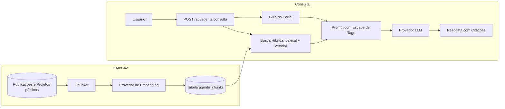
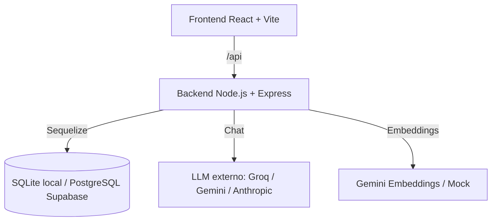

# IFConnect

Portal aberto de divulgação científica, educacional, cultural e comunitária, com vitrine de projetos que buscam apoio e assistente de IA baseado em conteúdo público.

Demonstração: [https://ifconnect.onrender.com/](https://ifconnect.onrender.com/)

## Sumário

- [Sobre o projeto](#sobre-o-projeto)
- [Funcionalidades](#funcionalidades)
- [Execução rápida](#execução-rápida)
- [Assistente de IA (RAG)](#assistente-de-ia-rag)
- [Arquitetura](#arquitetura)
- [Testes e qualidade](#testes-e-qualidade)
- [Implantação](#implantação)
- [Segurança](#segurança)
- [Limitações e próximos passos](#limitações-e-próximos-passos)
- [Documentação](#documentação)
- [Equipe e licença](#equipe-e-licença)

## Sobre o projeto

O IFConnect é um projeto acadêmico para aproximar estudantes, jovens jornalistas, professores e a comunidade na produção e leitura de conteúdo científico, educacional, cultural e comunitário. Sem paywall e com revisão por professores moderadores antes da publicação, reúne um mural de publicações e uma vitrine de projetos em busca de apoio.

## Funcionalidades

- **Visitante (sem conta):** lê publicações `publicado` e projetos `ativa`/`financiada`, consulta comentários, acessa `/ajuda` e `/sobre` e conversa com o Assistente de IA.
- **Pessoa cadastrada (`estudante`, `jornalista_jovem`, `membro_comunidade`):** envia publicações e projetos para revisão, edita itens enquanto não aprovados, acompanha o status em **Perfil** (**Minhas publicações** e **Minhas campanhas**), comenta em tempo real (SSE) e registra apoios em projetos ativos.
- **Professor moderador (`professor_moderador`):** analisa filas de revisão (`em_revisao` e `em_analise`), cria categorias e pode editar suas próprias publicações mesmo após aprovação. Não é criado por autocadastro público.

## Execução rápida

Pré-requisitos: Node.js e npm. No backend, copie `.env.example` para `.env` (troque `JWT_SECRET` em produção) e rode `seed` apenas em ambiente local (ele recria as tabelas, inclusive `agente_chunks`, que se reconstrói automaticamente ao subir o servidor com RAG ligado e chave configurada).

Terminal 1 (Backend na porta `4000`):

```bash
cd backend && npm install && cp .env.example .env && npm run seed && npm run dev
```

Terminal 2 (Frontend na porta `5173`, a partir da raiz do repositório):

```bash
cd frontend && npm install && npm run dev
```

> **Windows PowerShell:** use `Copy-Item .env.example .env` no lugar de `cp`. Se o `npm` for bloqueado por política de execução, use Git Bash, CMD, `npm.cmd`, ou execute `Set-ExecutionPolicy -Scope CurrentUser RemoteSigned`.

As 6 variáveis essenciais estão abaixo; a lista completa fica em [`docs/configuracao.md`](docs/configuracao.md):

| Variável | Papel | Padrão no `.env.example` |
|---|---|---|
| `JWT_SECRET` | Assinatura dos tokens JWT (segredo) | `troque-por-um-segredo-forte-em-producao` |
| `DATABASE_URL` | PostgreSQL em produção (vazia usa SQLite local) | *(comentada)* |
| `CORS_ORIGIN` | Origens permitidas em produção | *(comentada)* |
| `TRUST_PROXY` | Número de proxies reversos (ex.: `1`) | *(comentada)* |
| `AGENTE_IA_ENABLED` | Liga o assistente (`false` se omitida no código) | `true` |
| `AGENTE_IA_API_KEY` | Chave do LLM (vazia ativa fallback `busca`) | *(vazia)* |

## Assistente de IA (RAG)

O assistente responde dúvidas em português do Brasil sobre o uso do portal e sobre conteúdos **estritamente públicos** (artigos `publicado` e projetos `ativa` ou `financiada`), usando busca híbrida (lexical + vetorial via tabela `agente_chunks`), guia dinâmico de navegação, contexto opcional da página aberta e escape de `<` e `>` no prompt.



## Arquitetura



- **Frontend:** React `^18.3.1`, React Router DOM `^6.26.2`, Axios `^1.7.7`, Vite `^5.4.6`.
- **Backend:** Express `^4.19.2`, Sequelize `^6.37.3`, `sqlite3` `^5.1.7`, `pg` `^8.23.1`, `helmet` `^7.1.0`, `cors` `^2.8.5`, `express-rate-limit` `^7.4.0`, `jsonwebtoken` `^9.0.2`, `bcryptjs` `^2.4.3`.

## Testes e qualidade

Os testes automatizados usam Jest + Supertest com SQLite em memória (`:memory:`) e provedores mockados (`global.fetch` e provider `mock`), sem acesso à rede:

```bash
cd backend
npm test
```

- **Última execução (`npm test`, em 19/11/2026):** 31 suítes aprovadas, 351 testes aprovados.
- **Testes de mutação (Stryker, `npm run agente:mutacao`):** `93,49%` no total — detalhes em [`docs/agente/mutacao.md`](docs/agente/mutacao.md).
- **Avaliação do RAG (`npm run agente:eval`):** resultados com provedor real em [`docs/agente/avaliacao.md`](docs/agente/avaliacao.md).
- **Outros scripts (`backend/package.json`):** `npm run agente:reindex`, `npm run agente:smoke`, `npm run db:init`, `npm run db:check`.

## Implantação

Hospedado no Render ([https://ifconnect.onrender.com/](https://ifconnect.onrender.com/)) com banco PostgreSQL no Supabase (`DATABASE_URL` via Session pooler, porta `5432`, e `TRUST_PROXY=1`). Em planos gratuitos, Render pode hibernar por inatividade e Supabase pode pausar após 7 dias sem uso.

## Segurança

- Senhas com `bcryptjs`, autenticação JWT, `professor_moderador` bloqueado no autocadastro e publicações não publicadas restritas ao autor e moderadores.
- Cabeçalhos com `helmet`, `cors` configurável, rate limit global (`300` req / 15 min) e por IP no agente (`AGENTE_IA_RATE_LIMIT`), validação com `express-validator` derivada de [`backend/src/config/limites.js`](backend/src/config/limites.js) e RLS documentado em [`docs/banco/rls.sql`](docs/banco/rls.sql).
- Guarda no `seed` bloqueia execução destrutiva em hosts remotos sem `PERMITIR_SEED_REMOTO=sim`, `--confirmar-remoto` e confirmação interativa.

## Limitações e próximos passos

- Apoios a projetos registram compromisso na plataforma sem gateway de pagamento online.
- Recuperação de senha por e-mail, política de privacidade formal, canal de denúncias e armazenamento de imagens em nuvem (S3/CloudFront) ficam como próximos passos.

## Documentação

- [`docs/api.md`](docs/api.md) — referência completa das rotas REST e níveis de acesso.
- [`docs/configuracao.md`](docs/configuracao.md) — todas as variáveis de ambiente, padrões no código e `.env.example`.
- [`docs/modelo-de-dados.md`](docs/modelo-de-dados.md) — diagrama ER e descrição das tabelas (incluindo `Comment` e `agente_chunks`).
- [`docs/agente/spec-rag.md`](docs/agente/spec-rag.md), [`docs/agente/adr-0001-rag-vetores-em-tabela.md`](docs/agente/adr-0001-rag-vetores-em-tabela.md) e [`docs/agente/adr-0002-provedores-e-configuracao.md`](docs/agente/adr-0002-provedores-e-configuracao.md) — especificação e ADRs do RAG.
- [`docs/agente/cobertura-ca.md`](docs/agente/cobertura-ca.md), [`docs/agente/mutacao.md`](docs/agente/mutacao.md), [`docs/agente/avaliacao.md`](docs/agente/avaliacao.md) e [`docs/agente/checklist-snct.md`](docs/agente/checklist-snct.md) — qualidade, avaliação e apresentação.
- [`docs/banco/rls.sql`](docs/banco/rls.sql) — Row Level Security para PostgreSQL/Supabase.

## Equipe e licença

- **IFSP Câmpus Hortolândia** · Análise e Desenvolvimento de Sistemas · *Práticas em Sociedade e Informática III* (Prof. Carlos Eduardo Pagani).
- **Integrantes:** Luis M. S. Solera · Henrique C. Duarte · Vitor G. Quiroga.
- **Licença:** [MIT](LICENSE).
