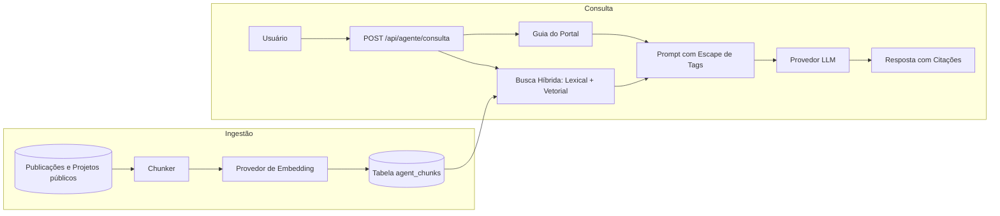
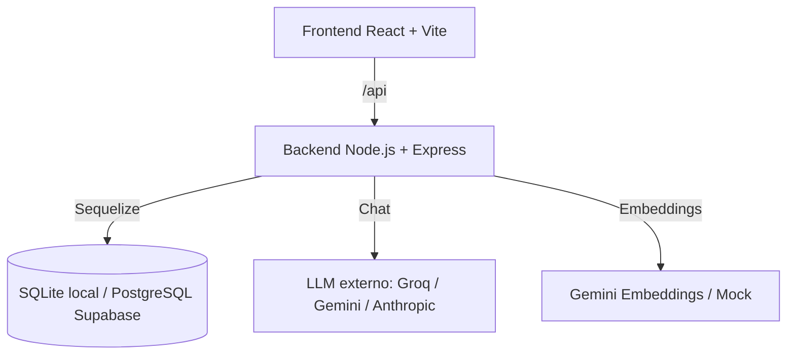
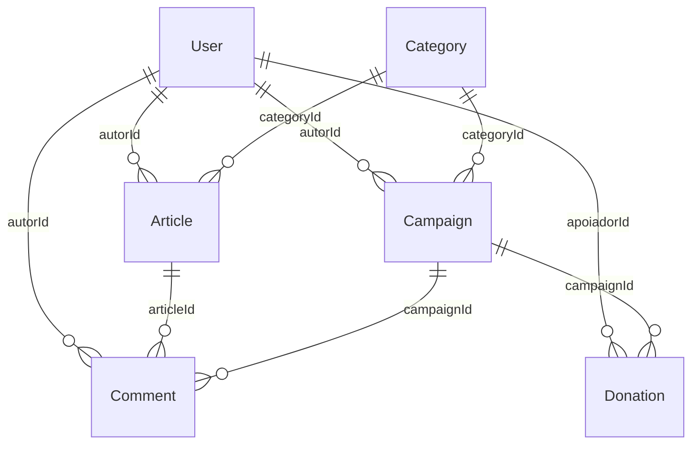

# IFConnect

Portal aberto de divulgação científica, educacional, cultural e comunitária, com vitrine de projetos que buscam apoio e assistente de IA baseado em conteúdo público.

Demonstração: [https://ifconnect.onrender.com/](https://ifconnect.onrender.com/)

<!--  -->

## Sumário

- [Sobre o projeto](#sobre-o-projeto)
- [Funcionalidades](#funcionalidades)
- [Assistente de IA (RAG)](#assistente-de-ia-rag)
- [Arquitetura](#arquitetura)
- [Modelo de dados](#modelo-de-dados)
- [Começando](#começando)
- [Configuração](#configuração)
- [Banco de dados](#banco-de-dados)
- [API](#api)
- [Testes e qualidade](#testes-e-qualidade)
- [Implantação](#implantação)
- [Segurança](#segurança)
- [Limitações conhecidas e próximos passos](#limitações-conhecidas-e-próximos-passos)
- [Documentação adicional](#documentação-adicional)
- [Equipe e contexto acadêmico](#equipe-e-contexto-acadêmico)
- [Contribuição e licença](#contribuição-e-licença)

## Sobre o projeto

O IFConnect nasceu como projeto acadêmico para aproximar estudantes, jovens jornalistas, professores e membros da comunidade em torno da produção e leitura de conteúdo científico, educacional, cultural e comunitário.

Sem paywall e com revisão por professores moderadores antes da publicação, o portal reúne dois espaços principais: um mural de publicações e uma vitrine científica para divulgação de projetos que buscam apoio.

## Funcionalidades

### Por perfil de usuário

- **Visitante (sem conta):** lê publicações aprovadas e projetos ativos ou financiados na vitrine, consulta comentários, acessa `/ajuda` e `/sobre` e conversa com o Assistente de IA.
- **Pessoa cadastrada (`estudante`, `jornalista_jovem`, `membro_comunidade`):** além do acesso público, envia publicações e projetos para análise, edita itens enquanto não aprovados, acompanha status no Perfil, comenta em tempo real e registra apoios em projetos ativos.
- **Professor moderador (`professor_moderador`):** analisa filas de publicações e projetos pendentes (aprova ou recusa), cria categorias e pode editar suas próprias publicações mesmo após aprovação. Contas desse perfil não são criadas por autocadastro público.

### Por área do sistema

- **Publicações:** suporte a `noticia_escolar`, `noticia_global`, `artigo_cientifico`, `texto`, `poema` e `projeto`, com filtros por tipo, tema, categoria e busca textual, além de comentários com atualização via SSE.
- **Vitrine científica:** projetos com meta financeira, barra de progresso, prazo opcional e registro direto de apoios (sem cobrança financeira online no momento).
- **Perfil:** visualização e edição de nome, instituição e bio, além das listas **Minhas publicações** e **Minhas campanhas**.
- **Moderação:** filas dedicadas para revisão de publicações (`em_revisao`) e projetos (`em_analise`), além de cadastro de categorias.
- **Ajuda e Assistente:** página `/ajuda` com guia dinâmico servido pela API, perguntas frequentes e busca no cliente; painel flutuante do Assistente de IA acessível em qualquer tela.

## Assistente de IA (RAG)

O assistente responde dúvidas em português do Brasil sobre o uso do portal e sobre conteúdos **estritamente públicos** (artigos `publicado` e projetos `ativa` ou `financiada`). Nunca acessa rascunhos, itens em revisão/análise, recusados, encerrados ou dados de usuários.



<!--  -->

### Recursos e segurança

- **Busca híbrida (RRF):** combina busca lexical e similaridade vetorial por embeddings armazenados no próprio banco (`agent_chunks`).
- **Contexto da página aberta:** quando o usuário está em `/publicacoes/:id` ou `/vitrine/:id`, pode pedir resumos ou explicações daquele item público.
- **Guia de navegação integrado:** orienta sobre cadastro, publicação, edição, apoio e acompanhamento usando os mesmos limites definidos em [`backend/src/config/limites.js`](backend/src/config/limites.js).
- **Fallback automático:** sem chave de LLM configurada (`AGENTE_IA_API_KEY` vazia) ou em falha do provedor, degrada para o modo `busca`.
- **Proteções:** escape de `<` e `>` em conteúdo de terceiros dentro do prompt, validação de tamanho da pergunta (2 a 500 caracteres) e rate limit próprio por IP (`AGENTE_IA_RATE_LIMIT`).
- **Interruptores:** `AGENTE_IA_ENABLED=false` desliga o assistente (`503` na API e oculto no frontend); `AGENTE_RAG_ENABLED=false` mantém o comportamento legado sem RAG.

## Arquitetura



### Tecnologias e versões

| Camada | Tecnologia | Versão (package.json) |
|---|---|---|
| Frontend | React / React DOM | `^18.3.1` |
| Roteamento | React Router DOM | `^6.26.2` |
| HTTP Client | Axios | `^1.7.7` |
| Build Frontend | Vite | `^5.4.6` |
| Backend | Express | `^4.19.2` |
| ORM | Sequelize | `^6.37.3` |
| Banco Local / Testes | SQLite3 | `^5.1.7` |
| Banco Produção | PostgreSQL (`pg`) | `^8.23.1` |
| Segurança / Auth | `helmet`, `cors`, `express-rate-limit`, `jsonwebtoken`, `bcryptjs` | `^7.1.0`, `^2.8.5`, `^7.4.0`, `^9.0.2`, `^2.4.3` |
| Testes / Mutação | Jest, Supertest, Stryker | `^29.7.0`, `^7.0.0`, `^10.1.1` |

### Estrutura de pastas

```text
IFConnect/
├── backend/
│   ├── scripts/        # Inicialização/checagem de banco e utilitários do agente
│   ├── src/
│   │   ├── config/     # Banco de dados e limites de validação (limites.js)
│   │   ├── controllers/# Regras de cada recurso com asyncHandler
│   │   ├── middleware/ # JWT, autorização por perfil, validação e erros
│   │   ├── models/     # Modelos Sequelize e associações
│   │   ├── routes/     # Rotas REST da API
│   │   ├── services/   # Módulo do agente (ingest, retrieval, generation, providers)
│   │   └── utils/      # Seed de exemplo e helpers
│   └── tests/          # Suíte Jest + Supertest e avaliação offline do RAG
├── docs/
│   ├── agente/         # Spec do RAG, ADRs, cobertura, mutação e checklist SNCT
│   └── banco/          # Script de Row Level Security (rls.sql)
└── frontend/
    └── src/
        ├── api/        # Cliente Axios (/api)
        ├── components/ # Navbar, Footer, AssistenteIA, cartões e comentários
        ├── config/     # Metadados do projeto (projeto.js)
        ├── content/    # Perguntas frequentes estáticas (faq.js)
        ├── context/    # AuthContext (JWT em localStorage)
        ├── pages/      # Páginas do portal, incluindo /ajuda e /sobre
        └── styles/     # Tokens visuais e CSS global ("Caderno de Campo")
```

## Modelo de dados



A tabela `agent_chunks` (`AgentChunk`) armazena de forma desacoplada os trechos e vetores de artigos publicados e campanhas ativas ou financiadas (`fonteTipo`, `fonteId`, `chunkIndex`, `conteudo`, `embedding`, `hashDocumento`).

## Começando

### Pré-requisitos

- **Node.js:** A definir (não há campo `engines` declarado em `package.json`).
- **npm:** instalado junto ao Node.js.

### Instalação e execução local

**1. Backend (API na porta `4000`)**

Windows (PowerShell):

```powershell
cd backend
npm install
Copy-Item .env.example .env
npm run seed
npm run dev
```

Linux / macOS / Git Bash:

```bash
cd backend
npm install
cp .env.example .env
npm run seed
npm run dev
```

> Edite `backend/.env` e defina um `JWT_SECRET` próprio antes de iniciar. O comando `npm run seed` cria dados fictícios somente no banco local e exibe as credenciais de exemplo geradas diretamente no terminal.

**2. Frontend (interface Vite na porta `5173`)**

```bash
cd frontend
npm install
npm run dev
```

O servidor de desenvolvimento do Vite encaminha requisições de `/api` para `http://localhost:4000`.

## Configuração

Variáveis declaradas em [`backend/.env.example`](backend/.env.example):

| Variável | Obrigatória? | Padrão | Descrição |
|---|---|---|---|
| `NODE_ENV` | Não | `development` | Ambiente de execução (`development`, `test`, `production`) |
| `PORT` | Não | `4000` | Porta HTTP da API |
| `JWT_SECRET` | **Sim** (segredo) | — | Chave de assinatura dos tokens JWT |
| `JWT_EXPIRES_IN` | Não | `7d` | Tempo de expiração do JWT |
| `CORS_ORIGIN` | Recomendada em prod | aberto se vazio | Origens permitidas separadas por vírgula |
| `TRUST_PROXY` | Atrás de proxy | — | Número de proxies reversos (ex.: `1`) para `req.ip` |
| `AGENTE_IA_ENABLED` | Não | `true` | Habilita ou desabilita o assistente (`503` quando `false`) |
| `AGENTE_IA_PROVIDER` | Não | `groq` | Provedor LLM (`groq`, `gemini`, `anthropic`) |
| `AGENTE_IA_API_KEY` | Não (segredo) | — | Chave da API do LLM (vazia ativa fallback `busca`) |
| `AGENTE_IA_MODEL` | Não | `openai/gpt-oss-120b` | Modelo de chat utilizado |
| `AGENTE_IA_TIMEOUT_MS` | Não | `8000` | Timeout de chamada ao LLM em milissegundos |
| `AGENTE_IA_RATE_LIMIT` | Não | `10` | Limite de perguntas por minuto por IP |
| `AGENTE_RAG_ENABLED` | Não | `false` | Ativa o pipeline RAG híbrido |
| `AGENTE_RAG_EMBEDDING_PROVIDER` | Não | `gemini` | Provedor de embeddings (`gemini` ou `mock`) |
| `AGENTE_RAG_EMBEDDING_MODEL` | Não | `gemini-embedding-001` | Modelo de embedding |
| `AGENTE_RAG_EMBEDDING_DIM` | Não | `768` | Dimensão esperada dos vetores |
| `AGENTE_RAG_EMBEDDING_API_KEY` | Não (segredo) | — | Chave de embedding (ou herda `AGENTE_IA_API_KEY` se `gemini`) |
| `AGENTE_RAG_TOP_K` | Não | `4` | Quantidade máxima de trechos no contexto do LLM |
| `AGENTE_RAG_MIN_SCORE` | Não | — | Limiar mínimo de similaridade vetorial |
| `AGENTE_RAG_RECONCILIAR_INTERVALO_MIN` | Não | `360` | Intervalo de reconciliação do índice em minutos (`0` = só startup) |
| `DATABASE_URL` | Produção (segredo) | — | String de conexão PostgreSQL (ex.: Supabase Session pooler) |
| `DB_SSL_CA_PATH` | Não | — | Caminho de certificado CA para conexão SSL |
| `PERMITIR_SEED_REMOTO` | Não | — | Trava extra exigida para liberar `seed` em host remoto |

## Banco de dados

- **Local e testes:** SQLite (`portal.sqlite` em desenvolvimento; `:memory:` em `NODE_ENV=test`, ignorando `DATABASE_URL`).
- **Produção:** PostgreSQL (Supabase) configurado via `DATABASE_URL` usando a string do **Session pooler** (porta `5432`).

Para inicializar tabelas e verificar conexão no banco configurado:

```bash
cd backend
npm run db:init
npm run db:check
```

### Guardas contra apagamento remoto e RLS

- O script `npm run seed` executa `sequelize.sync({ force: true })` e **bloqueia** a execução em hosts remotos, exigindo explicitamente `PERMITIR_SEED_REMOTO=sim`, a flag `--confirmar-remoto` e confirmação interativa do host mascarado no terminal.
- Para proteção no Supabase, execute [`docs/banco/rls.sql`](docs/banco/rls.sql) no *SQL Editor* para habilitar Row Level Security nas tabelas e desabilite a Data API (PostgREST) no painel do projeto.

## API

Todas as rotas respondem sob o prefixo `/api` e retornam erros no formato `{ erro: true, mensagem }`.

| Método | Rota | Descrição | Autenticação |
|---|---|---|---|
| `GET` | `/api/saude` | Status da API | Pública |
| `GET` | `/api/ajuda` | Guia do portal com limites interpolados (`Cache-Control: public, max-age=300`) | Pública |
| `POST` | `/api/auth/registrar` | Autocadastro (`estudante`, `jornalista_jovem`, `membro_comunidade`) | Pública |
| `POST` | `/api/auth/login` | Autenticação e emissão de JWT | Pública |
| `GET` | `/api/auth/perfil` | Dados do usuário autenticado | JWT |
| `PATCH` | `/api/auth/perfil` | Atualiza nome, instituição e bio | JWT |
| `GET` | `/api/categorias` | Lista categorias ordenadas por nome | Pública |
| `POST` | `/api/categorias` | Cria nova categoria | `professor_moderador` |
| `GET` | `/api/artigos` | Lista publicações publicadas (com filtros) | Pública |
| `GET` | `/api/artigos/:id` | Detalhe de publicação (restrito se não publicada) | Opcional / Autor / Moderador |
| `GET` | `/api/artigos/minhas/publicacoes` | Lista publicações do próprio usuário | JWT |
| `GET` | `/api/artigos/moderacao/pendentes` | Fila de publicações em revisão | `professor_moderador` |
| `POST` | `/api/artigos` | Cria publicação (`em_revisao` ou `publicado` se moderador) | JWT |
| `PUT` | `/api/artigos/:id` | Edita publicação própria (reenvia recusada para revisão) | JWT (Autor) |
| `DELETE` | `/api/artigos/:id` | Exclui publicação própria | JWT (Autor) |
| `PATCH` | `/api/artigos/:id/moderar` | Aprova (`publicado`) ou recusa (`recusado`) | `professor_moderador` |
| `GET` | `/api/artigos/:id/comentarios` | Lista comentários da publicação | Pública |
| `GET` | `/api/artigos/:id/comentarios/stream` | Stream SSE de novos comentários | Pública |
| `POST` | `/api/artigos/:id/comentarios` | Publica comentário | JWT |
| `GET` | `/api/campanhas` | Lista projetos ativos ou financiados na vitrine | Pública |
| `GET` | `/api/campanhas/:id` | Detalhe de projeto | Opcional / Autor / Moderador |
| `GET` | `/api/campanhas/minhas/campanhas` | Lista projetos do próprio usuário | JWT |
| `GET` | `/api/campanhas/moderacao/pendentes` | Fila de projetos em análise | `professor_moderador` |
| `POST` | `/api/campanhas` | Cadastra projeto (`em_analise`) | JWT |
| `PUT` | `/api/campanhas/:id` | Edita projeto próprio enquanto `em_analise` | JWT (Autor) |
| `PATCH` | `/api/campanhas/:id/moderar` | Aprova (`ativa`) ou recusa (`encerrada`) | `professor_moderador` |
| `GET` | `/api/campanhas/:id/comentarios` | Lista comentários do projeto | Pública |
| `GET` | `/api/campanhas/:id/comentarios/stream` | Stream SSE de comentários do projeto | Pública |
| `POST` | `/api/campanhas/:id/comentarios` | Publica comentário no projeto | JWT |
| `PUT` | `/api/comentarios/:id` | Edita comentário próprio | JWT (Autor) |
| `DELETE` | `/api/comentarios/:id` | Exclui comentário próprio | JWT (Autor) |
| `POST` | `/api/doacoes/:campaignId` | Registra apoio em projeto ativo | JWT |
| `GET` | `/api/agente/status` | Retorna `{ habilitado: boolean }` | Pública |
| `POST` | `/api/agente/consulta` | Consulta o Assistente de IA (rate limit por IP) | Pública |

## Testes e qualidade

Os testes automatizados utilizam Jest + Supertest com SQLite em memória e provedores de IA/embeddings mockados (`global.fetch` e provider `mock`), sem acesso à rede.

```bash
cd backend
npm test
```

Scripts adicionais de qualidade do agente disponíveis em `backend/package.json`:

- `npm run agente:reindex` — indexação idempotente dos conteúdos públicos em `agent_chunks`.
- `npm run agente:eval` — avaliação offline de recuperação (`tests/agente/eval/dataset.json`). Métricas com provedor real: *preencher após executar*.
- `npm run agente:smoke` — smoke test HTTP contra `BASE_URL`. Resultados: *preencher após executar*.
- `npm run agente:mutacao` — testes de mutação com Stryker. Resultados: *preencher após executar*.

## Implantação

A demonstração publicada está hospedada em [https://ifconnect.onrender.com/](https://ifconnect.onrender.com/) (Render), conectada a banco PostgreSQL (Supabase).

Variáveis essenciais em produção: `NODE_ENV=production`, `JWT_SECRET`, `DATABASE_URL`, `CORS_ORIGIN` e `TRUST_PROXY=1` (atrás do proxy reverso da plataforma). Caso o assistente esteja ativo, configurar também `AGENTE_IA_ENABLED`, `AGENTE_IA_PROVIDER`, `AGENTE_IA_API_KEY`, `AGENTE_RAG_ENABLED` e as variáveis de embedding correspondentes.

- **Observações do plano gratuito (confirmar):** instâncias gratuitas no Render podem hibernar por inatividade (aumentando o tempo da primeira resposta), e projetos gratuitos no Supabase entram em pausa após 7 dias sem uso.

## Segurança

- Senhas armazenadas com hash `bcryptjs`; sessões autenticadas por token JWT com expiração configurável.
- Controle de acesso por perfil (`professor_moderador` bloqueado no autocadastro).
- Cabeçalhos de proteção com `helmet`, política de `cors` configurável, rate limiting global (`300` req / 15 min) e específico para o agente (`AGENTE_IA_RATE_LIMIT` / min), além de validação de entrada com `express-validator` derivada de [`backend/src/config/limites.js`](backend/src/config/limites.js).
- Row Level Security documentado em [`docs/banco/rls.sql`](docs/banco/rls.sql).
- **Não coberto na versão atual:** recuperação de senha por e-mail, gateway de pagamento real para apoios, política de privacidade formal e canal dedicado de denúncias.

## Limitações conhecidas e próximos passos

- O apoio a projetos registra o compromisso diretamente na plataforma, sem cobrança financeira online.
- Itens institucionais como política de privacidade, canal de denúncia, e-mail de suporte e prazos formais de moderação ainda dependem de definição da equipe.
- Possibilidades futuras documentadas incluem armazenamento de imagens em nuvem (S3/CloudFront) e automação de CI/CD.

## Documentação adicional

- [`docs/agente/spec-rag.md`](docs/agente/spec-rag.md) — especificação do Assistente de IA (RAG).
- [`docs/agente/adr-0001-rag-vetores-em-tabela.md`](docs/agente/adr-0001-rag-vetores-em-tabela.md) e [`docs/agente/adr-0002-provedores-e-configuracao.md`](docs/agente/adr-0002-provedores-e-configuracao.md) — decisões arquiteturais.
- [`docs/agente/cobertura-ca.md`](docs/agente/cobertura-ca.md) e [`docs/agente/mutacao.md`](docs/agente/mutacao.md) — cobertura e testes de mutação.
- [`docs/agente/checklist-snct.md`](docs/agente/checklist-snct.md) — checklist operacional para apresentação.
- [`docs/banco/rls.sql`](docs/banco/rls.sql) — políticas de Row Level Security para PostgreSQL/Supabase.

## Equipe e contexto acadêmico

- **Instituição:** Instituto Federal de São Paulo, Câmpus Hortolândia
- **Curso:** Análise e Desenvolvimento de Sistemas
- **Disciplina:** Práticas em Sociedade e Informática III
- **Professor orientador:** Carlos Eduardo Pagani
- **Integrantes:** Luis M. S. Solera · Henrique C. Duarte · Vitor G. Quiroga

## Contribuição e licença

- **Contribuição:** A definir (não há arquivo `CONTRIBUTING.md` no repositório).
- **Licença:** A definir (não há arquivo `LICENSE` no repositório).
