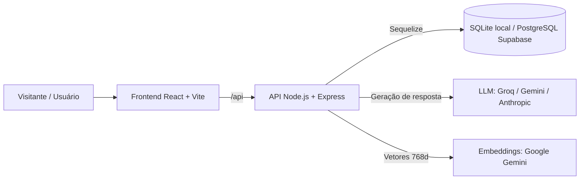
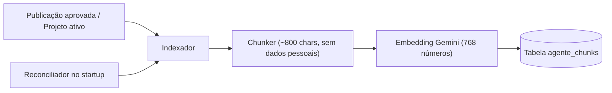
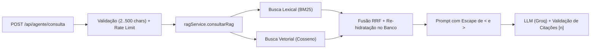

# Guia do Código para Apresentação — IFConnect

Mapa direto ao código para localizar em segundos qualquer regra, algoritmo ou componente durante a apresentação ao vivo. Demonstração publicada: [https://ifconnect.onrender.com/](https://ifconnect.onrender.com/).

## 1. Atalho de 60 segundos

1. [`consultarRag`](../../backend/src/services/agente/ragService.js#L68-L113) — orquestra o assistente: detecta pergunta sobre a página aberta, aciona a busca híbrida e seleciona o guia do portal.
2. [`recuperar`](../../backend/src/services/agente/retrieval/hybrid.js#L124-L153) — executa a busca híbrida (palavras + significado), funde os resultados e remove qualquer item não público no banco.
3. [`criarGeminiEmbeddingProvider`](../../backend/src/services/agente/providers/embedding/gemini.js#L97-L127) — converte textos e perguntas em vetores numéricos de 768 dimensões usando a API do Google Gemini.
4. [`montarMensagemUsuario`](../../backend/src/services/agente/generation/prompt.js#L149-L160) — monta o prompt enviado à IA isolando `<guia>`, `<contexto>` com tags escapadas e `<pergunta>` sanitizada.
5. [`generate`](../../backend/src/services/agente/providers/llm/groq.js#L4-L43) — cliente HTTP do provedor Groq que gera a resposta final em português com temperatura baixa (`0.3`).
6. [`AssistenteIA`](../../frontend/src/components/AssistenteIA.jsx#L30-L77) — chat flutuante em React que detecta a página atual, sugere atalhos e transforma citações em links internos.

## 2. Mapa do repositório

```text
IFConnect/
├── backend/
│   ├── scripts/             # Inicialização/checagem de banco, smoke test e verificador deste guia
│   ├── src/
│   │   ├── config/          # Conexão Sequelize (database.js) e fonte única de limites (limites.js)
│   │   ├── controllers/     # Regras de negócio HTTP (artigos, campanhas, comentários, ajuda, agente)
│   │   ├── middleware/      # JWT (auth.js), validação (validate.js) e tratamento de erros
│   │   ├── models/          # User, Article, Campaign, Category, Donation, Comment e AgentChunk
│   │   ├── routes/          # Rotas REST sob /api com express-validator e rate limit
│   │   ├── services/        # Porta de entrada agenteService.js, SSE e submódulos em services/agente/
│   │   └── utils/           # asyncHandler.js e seed.js (dados fictícios locais)
│   └── tests/               # Suíte Jest + Supertest e avaliação offline em tests/agente/eval/
├── docs/
│   ├── agente/              # Especificação do RAG, ADRs, cobertura, mutação, avaliação e checklist
│   ├── apresentacao/        # Este guia de código e o roteiro de apresentação
│   └── banco/               # Script SQL de Row Level Security (rls.sql) para PostgreSQL/Supabase
└── frontend/
    └── src/
        ├── api/             # Cliente Axios com interceptor JWT (client.js)
        ├── components/      # AssistenteIA, CommentsSection, Navbar, Footer e cartões
        ├── config/          # Dados institucionais e URL da demonstração (projeto.js)
        ├── content/         # Perguntas frequentes estáticas (faq.js)
        ├── context/         # Sessão de autenticação no cliente (AuthContext.jsx)
        └── pages/           # Páginas do portal, incluindo Help (/ajuda) e About (/sobre)
```

Navegação direta pelas pastas principais: [`backend/src/`](../../backend/src/), [`backend/src/services/agente/`](../../backend/src/services/agente/), [`backend/tests/agente/`](../../backend/tests/agente/), [`frontend/src/`](../../frontend/src/), [`docs/agente/`](../../docs/agente/).

## 3. Arquitetura

*RAG (Retrieval-Augmented Generation / geração aumentada por recuperação)* é a técnica que busca trechos reais do banco antes de chamar o modelo de linguagem, evitando respostas inventadas.



| Etapa na arquitetura | Arquivo e símbolo | Papel no sistema |
|---|---|---|
| Interface web e chat | [`App.jsx`](../../frontend/src/App.jsx), [`AssistenteIA`](../../frontend/src/components/AssistenteIA.jsx#L30-L77) | Renderiza o portal e o painel flutuante do assistente. |
| Cliente HTTP | [`api`](../../frontend/src/api/client.js#L3-L10) | Encaminha chamadas para `/api` anexando o token JWT quando autenticado. |
| Servidor Express | [`app`](../../backend/src/app.js#L18-L55), [`iniciar`](../../backend/src/server.js#L7-L20) | Configura segurança HTTP, rate limit, rotas REST, banco e reconciliação. |
| Persistência | [`criarSequelize`](../../backend/src/config/database.js#L122-L172) | Alterna entre SQLite local/testes e PostgreSQL via `DATABASE_URL`. |
| Serviços de IA | [`consultarRag`](../../backend/src/services/agente/ragService.js#L68-L113), [`criarGeminiEmbeddingProvider`](../../backend/src/services/agente/providers/embedding/gemini.js#L97-L127) | Consulta embeddings no Gemini e gera respostas textuais via Groq (ou Gemini/Anthropic). |

### Tecnologias e versões reais

Fontes: [`backend/package.json`](../../backend/package.json) e [`frontend/package.json`](../../frontend/package.json).

| Camada | Pacotes | Versões declaradas |
|---|---|---|
| Frontend | `react`, `react-dom`, `react-router-dom`, `axios`, `vite` | `^18.3.1`, `^18.3.1`, `^6.26.2`, `^1.7.7`, `^5.4.6` |
| Backend e ORM | `express`, `sequelize`, `sqlite3`, `pg`, `dotenv` | `^4.19.2`, `^6.37.3`, `^5.1.7`, `^8.23.1`, `^16.4.5` |
| Segurança e Validação | `helmet`, `cors`, `express-rate-limit`, `express-validator`, `jsonwebtoken`, `bcryptjs` | `^7.1.0`, `^2.8.5`, `^7.4.0`, `^7.2.0`, `^9.0.2`, `^2.4.3` |
| Testes e Qualidade | `jest`, `supertest`, `@stryker-mutator/core` | `^29.7.0`, `^7.0.0`, `^10.1.1` |

## 4. Fluxo A — Indexação

*Chunk (trecho)* é cada fatia de até 800 caracteres em que um texto longo é dividido; *embedding* é a lista de 768 números que representa o significado desse trecho.



| Etapa | Arquivo e função | O que faz |
|---|---|---|
| Gatilho editorial | [`moderar`](../../backend/src/controllers/articleController.js#L130-L139), [`agendarIndexacao`](../../backend/src/services/agente/ingest/indexer.js#L221-L232) | Dispara a indexação em segundo plano ao criar, editar ou moderar conteúdo, sem travar a resposta HTTP. |
| Verificação de status e hash | [`ehPublico`](../../backend/src/services/agente/ingest/indexer.js#L24-L32), [`indexarFonte`](../../backend/src/services/agente/ingest/indexer.js#L67-L121) | Apaga chunks se o item deixou de ser público e pula o reprocessamento se o hash SHA-256 não mudou. |
| Divisão em trechos | [`montarDocumentoArtigo`](../../backend/src/services/agente/ingest/chunker.js#L215-L236), [`dividirDocumento`](../../backend/src/services/agente/ingest/chunker.js#L270-L326) | Omite autor e metas financeiras, prefixa o título em todo trecho e divide em blocos de até 800 caracteres. |
| Geração de vetores | [`embedDocumentos`](../../backend/src/services/agente/ingest/embedder.js#L118-L159), [`embedDocuments`](../../backend/src/services/agente/providers/embedding/gemini.js#L111-L156) | Deduplica textos iguais, envia lotes com `RETRIEVAL_DOCUMENT` ao Gemini e normaliza os vetores. |
| Gravação transacional | [`bulkCreate`](../../backend/src/services/agente/ingest/indexer.js#L155-L176), [`AgentChunk`](../../backend/src/models/AgentChunk.js#L22-L56) | Substitui os trechos antigos pelos novos dentro de uma única transação Sequelize. |
| Reconciliação automática | [`iniciarReconciliacao`](../../backend/src/services/agente/ingest/reconciliador.js#L63-L94), [`reindexarTudo`](../../backend/src/services/agente/ingest/reindex.js#L50-L102) | Sincroniza conteúdos públicos faltantes e remove órfãos ao subir o servidor e a cada 360 minutos. |

## 5. Fluxo B — Consulta

*BM25* pontua coincidência exata de palavras; *similaridade de cosseno* mede proximidade de significado entre vetores; *RRF (Reciprocal Rank Fusion)* combina as duas listas pelas posições.



| Etapa | Arquivo e função | O que faz |
|---|---|---|
| Validação e limite por IP | [`limitador`](../../backend/src/routes/agenteRoutes.js#L9-L18), [`consultar`](../../backend/src/controllers/agenteController.js#L9-L15) | Aplica limite por IP, exige pergunta de 2 a 500 caracteres e retorna `503` se o assistente estiver desligado. |
| Chaveamento RAG vs. legado | [`responder`](../../backend/src/services/agenteService.js#L223-L251) | Encaminha para o RAG quando `AGENTE_RAG_ENABLED=true` ou preserva o fluxo legado caso desligado/erro. |
| Orquestração da consulta | [`consultarRag`](../../backend/src/services/agente/ragService.js#L68-L113) | Trata resumos da página aberta, chama a recuperação híbrida, busca o guia de uso e evita chamar LLM sem contexto. |
| Busca dupla + RRF + filtro | [`buscarLexical`](../../backend/src/services/agente/retrieval/lexical.js#L98-L148), [`buscarVetorial`](../../backend/src/services/agente/retrieval/vector.js#L10-L22), [`recuperar`](../../backend/src/services/agente/retrieval/hybrid.js#L124-L153) | Une os rankings BM25 e vetorial via RRF e reconsulta o banco para garantir que só itens públicos sigam adiante. |
| Montagem segura do prompt | [`escaparTags`](../../backend/src/services/agente/generation/prompt.js#L26-L29), [`montarMensagemUsuario`](../../backend/src/services/agente/generation/prompt.js#L149-L160) | Empacota `<guia>`, `<contexto>` JSON escapado e `<pergunta>` sanitizada sob regras contra injeção de instruções. |
| Geração e limpeza de citações | [`generate`](../../backend/src/services/agente/providers/llm/groq.js#L4-L43), [`processarCitacoes`](../../backend/src/services/agente/generation/citacoes.js#L33-L74) | Gera a resposta no LLM, remove marcadores `[n]` inexistentes, ajusta pontuação e devolve apenas fontes válidas. |

## 6. Onde está cada coisa

### Orquestração do assistente
- **Arquivos:** [`agenteService.js`](../../backend/src/services/agenteService.js), [`ragService.js`](../../backend/src/services/agente/ragService.js)
- **Funções-chave:** [`responder`](../../backend/src/services/agenteService.js#L223-L251), [`consultarRag`](../../backend/src/services/agente/ragService.js#L68-L113) (fluxo de entrada) e [`fallbackBusca`](../../backend/src/services/agente/ragService.js#L58-L66)
- **O que faz:** `responder` funciona como porta de entrada com *feature flag* (interruptor de configuração), delegando para `consultarRag` quando o RAG está ativo. `consultarRag` coordena contexto da página, busca híbrida, guia do portal, chamada ao LLM e degradação para modo `busca`.
- **Para mostrar na apresentação:** aponte as linhas 79 a 119 de `ragService.js` para mostrar toda a árvore de decisão cabendo em meia tela.

### Embeddings (Gemini)
- **Arquivos:** [`embedder.js`](../../backend/src/services/agente/ingest/embedder.js), [`gemini.js`](../../backend/src/services/agente/providers/embedding/gemini.js), [`vetor.js`](../../backend/src/services/agente/providers/embedding/vetor.js)
- **Funções-chave:** [`embedDocumentos`](../../backend/src/services/agente/ingest/embedder.js#L118-L159), [`embedPergunta`](../../backend/src/services/agente/ingest/embedder.js#L165-L188), [`criarGeminiEmbeddingProvider`](../../backend/src/services/agente/providers/embedding/gemini.js#L97-L127) (lotes de documentos), [`embedQuery`](../../backend/src/services/agente/providers/embedding/gemini.js#L158-L196), [`normalizarL2`](../../backend/src/services/agente/providers/embedding/vetor.js#L5-L9)
- **O que faz:** Transforma textos em vetores de 768 números normalizados em comprimento unitário (norma L2) e mantém cache em memória para perguntas repetidas. Usa `RETRIEVAL_DOCUMENT` com retentativa na indexação e `RETRIEVAL_QUERY` com timeout curto de 3 segundos sem retry na consulta.
- **Para mostrar na apresentação:** destaque a diferença intencional entre `RETRIEVAL_DOCUMENT` e `RETRIEVAL_QUERY` em `gemini.js`.

### Divisão em trechos (chunking)
- **Arquivos:** [`chunker.js`](../../backend/src/services/agente/ingest/chunker.js)
- **Funções-chave:** [`encontrarPontoDeCorte`](../../backend/src/services/agente/ingest/chunker.js#L84-L125), [`dividir`](../../backend/src/services/agente/ingest/chunker.js#L136-L192) (laço de fatiamento), [`montarDocumentoArtigo`](../../backend/src/services/agente/ingest/chunker.js#L215-L236), [`dividirDocumento`](../../backend/src/services/agente/ingest/chunker.js#L270-L326), [`hashDocumento`](../../backend/src/services/agente/ingest/chunker.js#L332-L350)
- **O que faz:** Corta textos longos em blocos de até 800 caracteres com sobreposição de 100 caracteres, priorizando fim de parágrafo ou frase sem quebrar emojis UTF-16. Também remove dados pessoais e valores financeiros antes de gerar os trechos e calcula o hash SHA-256 para evitar reindexações desnecessárias.
- **Para mostrar na apresentação:** mostre `montarDocumentoArtigo` e `montarDocumentoCampanha` provando que nome do autor e e-mail nunca entram no texto indexado.

### Busca por palavras (BM25)
- **Arquivos:** [`lexical.js`](../../backend/src/services/agente/retrieval/lexical.js), [`texto.js`](../../backend/src/services/agente/retrieval/texto.js), [`indice.js`](../../backend/src/services/agente/retrieval/indice.js)
- **Funções-chave:** [`tokenizar`](../../backend/src/services/agente/retrieval/texto.js#L52-L59), [`obterOuConstruirLexical`](../../backend/src/services/agente/retrieval/lexical.js#L21-L66), [`buscarLexical`](../../backend/src/services/agente/retrieval/lexical.js#L98-L148), [`carregarIndice`](../../backend/src/services/agente/retrieval/indice.js#L19-L73)
- **O que faz:** Remove acentos e palavras vazias (*stopwords*), reduz plurais comuns em português e pontua os trechos pela fórmula clássica BM25 sobre o índice em memória. Multiplica por 3 o peso dos termos presentes na linha de título de cada trecho.
- **Para mostrar na apresentação:** mostre `PESO_TITULO = 3` e o cálculo de `idf` em `buscarLexical`, explicando que funciona 100% local mesmo sem internet.

### Busca por significado (similaridade de cosseno)
- **Arquivos:** [`vector.js`](../../backend/src/services/agente/retrieval/vector.js), [`vectorStore.js`](../../backend/src/services/agente/retrieval/vectorStore.js)
- **Funções-chave:** [`buscarVetorial`](../../backend/src/services/agente/retrieval/vector.js#L10-L22), [`produtoEscalar`](../../backend/src/services/agente/retrieval/vectorStore.js#L14-L23), [`criarVectorStoreSqlite`](../../backend/src/services/agente/retrieval/vectorStore.js#L40-L89)
- **O que faz:** Converte a pergunta em vetor e calcula o produto escalar contra os vetores `Float32Array` armazenados (equivalente ao cosseno porque ambos já estão normalizados). Ignora automaticamente qualquer vetor gerado por modelo ou dimensão diferente do atual.
- **Para mostrar na apresentação:** aponte a checagem `entrada.embeddingModel !== embeddingModel` na linha 61 de `vectorStore.js` e explique como a interface prepara a troca futura para `pgvector`.

### Fusão dos rankings (RRF)
- **Arquivos:** [`hybrid.js`](../../backend/src/services/agente/retrieval/hybrid.js)
- **Funções-chave:** [`fundirRrf`](../../backend/src/services/agente/retrieval/hybrid.js#L36-L62), [`recuperar`](../../backend/src/services/agente/retrieval/hybrid.js#L124-L153)
- **O que faz:** Combina a lista ordenada do BM25 com a lista ordenada da busca vetorial somando `1 / (60 + posição)` para cada trecho. Assim, um trecho que aparece bem colocado nos dois métodos sobe ao topo sem precisar calibrar pesos entre escalas diferentes.
- **Para mostrar na apresentação:** exiba `fundirRrf`, uma função pura de 27 linhas fácil de explicar no projetor.

### Filtro de segurança por status
- **Arquivos:** [`hybrid.js`](../../backend/src/services/agente/retrieval/hybrid.js), [`indexer.js`](../../backend/src/services/agente/ingest/indexer.js)
- **Funções-chave:** [`carregarFontesPublicas`](../../backend/src/services/agente/retrieval/hybrid.js#L67-L92), [`descartadosPorStatus`](../../backend/src/services/agente/retrieval/hybrid.js#L190-L197), [`ehPublico`](../../backend/src/services/agente/ingest/indexer.js#L24-L32)
- **O que faz:** Antes de selecionar os melhores trechos, reconsulta as tabelas `articles` e `campaigns` exigindo `status = 'publicado'` ou `status IN ('ativa', 'financiada')`. Mesmo que exista um chunk obsoleto no índice após uma recusa recente, ele é descartado imediatamente.
- **Para mostrar na apresentação:** mostre `carregarFontesPublicas` para provar que nem autor nem rascunhos jamais chegam ao prompt.

### Montagem do prompt e defesa contra injeção
- **Arquivos:** [`prompt.js`](../../backend/src/services/agente/generation/prompt.js)
- **Funções-chave:** [`SYSTEM_PROMPT_RAG`](../../backend/src/services/agente/generation/prompt.js#L12-L21), [`escaparTags`](../../backend/src/services/agente/generation/prompt.js#L26-L29), [`sanitizarPergunta`](../../backend/src/services/agente/generation/prompt.js#L34-L39), [`construirContexto`](../../backend/src/services/agente/generation/prompt.js#L60-L95), [`montarMensagemUsuario`](../../backend/src/services/agente/generation/prompt.js#L149-L160)
- **O que faz:** *Prompt injection (injeção de comando)* ocorre quando um texto tenta enganar a IA para ignorar suas regras. O módulo remove `<` e `>` da pergunta, escapa `<` e `>` no JSON do contexto (`\u003c` e `\u003e`) para impedir fechamento falso de `</contexto>` e instrui o modelo a tratar todo o conteúdo como dado não confiável.
- **Para mostrar na apresentação:** mostre `escaparTags` junto com a linha 19 do `SYSTEM_PROMPT_RAG`.

### Provedores de LLM (Groq, Gemini, Anthropic)
- **Arquivos:** [`groq.js`](../../backend/src/services/agente/providers/llm/groq.js), [`gemini.js`](../../backend/src/services/agente/providers/llm/gemini.js), [`anthropic.js`](../../backend/src/services/agente/providers/llm/anthropic.js), [`index.js`](../../backend/src/services/agente/providers/llm/index.js), [`http.js`](../../backend/src/services/agente/providers/http.js)
- **Funções-chave:** [`getLlmProvider`](../../backend/src/services/agente/providers/llm/index.js#L11-L14), [`generate`](../../backend/src/services/agente/providers/llm/groq.js#L4-L43) (Groq), [`generate`](../../backend/src/services/agente/providers/llm/gemini.js#L4-L40) (Gemini), [`generate`](../../backend/src/services/agente/providers/llm/anthropic.js#L4-L45) (Anthropic), [`fetchJsonComTimeout`](../../backend/src/services/agente/providers/http.js#L6-L34)
- **O que faz:** Encapsula três provedores de modelos de linguagem sob a mesma assinatura `generate({ system, user, config })` com cancelamento real por `AbortController`. Trocar de fornecedor exige apenas mudar `AGENTE_IA_PROVIDER` e `AGENTE_IA_MODEL` no ambiente.
- **Para mostrar na apresentação:** abra `providers/llm/index.js` para demonstrar o desacoplamento em 17 linhas.

### Citações e limpeza de texto
- **Arquivos:** [`citacoes.js`](../../backend/src/services/agente/generation/citacoes.js), [`AssistenteIA.jsx`](../../frontend/src/components/AssistenteIA.jsx) *(observação: o arquivo `generation/textoSimples.js` citado em rascunhos preliminares não encontrado no repositório; a limpeza vive em `citacoes.js`)*
- **Funções-chave:** [`limparEspacosEPontuacao`](../../backend/src/services/agente/generation/citacoes.js#L8-L23), [`processarCitacoes`](../../backend/src/services/agente/generation/citacoes.js#L33-L74)
- **O que faz:** Analisa marcadores como `[1]` ou `[1, 2]` gerados pelo modelo e remove qualquer número que não pertença às fontes realmente enviadas no contexto. Em seguida, corrige espaços e vírgulas órfãs antes de pontos, enquanto o React renderiza o texto puro sem `innerHTML`.
- **Para mostrar na apresentação:** mostre `processarCitacoes` impedindo que o assistente cite uma fonte `[9]` inexistente.

### Guia de uso do site
- **Arquivos:** [`guia.js`](../../backend/src/services/agente/generation/guia.js), [`intencao.js`](../../backend/src/services/agente/generation/intencao.js), [`ajudaController.js`](../../backend/src/controllers/ajudaController.js)
- **Funções-chave:** [`ehPerguntaDeNavegacao`](../../backend/src/services/agente/generation/intencao.js#L62-L69), [`pontuarSecao`](../../backend/src/services/agente/generation/guia.js#L357-L400), [`selecionarGuia`](../../backend/src/services/agente/generation/guia.js#L402-L435), [`obterGuia`](../../backend/src/controllers/ajudaController.js#L6-L20)
- **O que faz:** Mantém um guia passo a passo que interpola automaticamente as constantes de [`limites.js`](../../backend/src/config/limites.js) (tamanhos de título, senha, resumo e tipos aceitos). Serve tanto ao bloco `<guia>` do assistente quanto à rota pública `GET /api/ajuda`.
- **Para mostrar na apresentação:** mostre as linhas 7 a 25 de `guia.js` importando os limites reais dos formulários para nunca divergir da validação.

### Resumo da página aberta
- **Arquivos:** [`pagina.js`](../../backend/src/services/agente/generation/pagina.js), [`AssistenteIA.jsx`](../../frontend/src/components/AssistenteIA.jsx)
- **Funções-chave:** [`detectarPagina`](../../frontend/src/components/AssistenteIA.jsx#L13-L28), [`ehPerguntaSobrePagina`](../../backend/src/services/agente/generation/pagina.js#L104-L125), [`carregarContextoPagina`](../../backend/src/services/agente/generation/pagina.js#L133-L183)
- **O que faz:** Quando o visitante está em `/publicacoes/:id` ou `/vitrine/:id` e faz uma pergunta dêitica (como *"Resumir esta publicação"*), carrega até 12.000 caracteres daquele item direto do banco. Se o item não estiver público, bloqueia o resumo sem chamar o LLM.
- **Para mostrar na apresentação:** clique no chip *"Resumir esta publicação"* ao vivo e mostre `ehPerguntaSobrePagina` no código.

### Reconciliação automática do índice
- **Arquivos:** [`reconciliador.js`](../../backend/src/services/agente/ingest/reconciliador.js), [`reindex.js`](../../backend/src/services/agente/ingest/reindex.js)
- **Funções-chave:** [`reconciliarAgora`](../../backend/src/services/agente/ingest/reconciliador.js#L11-L57), [`iniciarReconciliacao`](../../backend/src/services/agente/ingest/reconciliador.js#L63-L94), [`reindexarTudo`](../../backend/src/services/agente/ingest/reindex.js#L50-L102)
- **O que faz:** Ao iniciar o servidor (exceto em testes) e em intervalos periódicos configuráveis, verifica se algum conteúdo público ficou sem embedding ou se restaram chunks órfãos. Roda em segundo plano com trava contra execuções simultâneas e sem derrubar a API em caso de falha.
- **Para mostrar na apresentação:** mostre `server.js` chamando `iniciarReconciliacao()` logo após subir a porta HTTP.

### Configuração e variáveis `AGENTE_*`
- **Arquivos:** [`config.js`](../../backend/src/services/agente/config.js), [`.env.example`](../../backend/.env.example)
- **Funções-chave:** [`parseNumber`](../../backend/src/services/agente/config.js#L6-L10), [`getConfig`](../../backend/src/services/agente/config.js#L12-L54)
- **O que faz:** Lê `process.env` dinamicamente a cada chamada, aplicando padrões seguros para timeouts, `topK`, dimensão do vetor e intervalo de reconciliação. Quando `AGENTE_IA_PROVIDER=gemini` e `AGENTE_RAG_EMBEDDING_API_KEY` está vazia, reaproveita `AGENTE_IA_API_KEY`.
- **Para mostrar na apresentação:** destaque a clareza de `getConfig` centralizando todas as flags do assistente em um único objeto.

### Rota, limite por IP e interruptores
- **Arquivos:** [`agenteRoutes.js`](../../backend/src/routes/agenteRoutes.js), [`agenteController.js`](../../backend/src/controllers/agenteController.js)
- **Funções-chave:** [`limitador`](../../backend/src/routes/agenteRoutes.js#L9-L18), [`consultarStatus`](../../backend/src/controllers/agenteController.js#L5-L7), [`consultar`](../../backend/src/controllers/agenteController.js#L9-L15)
- **O que faz:** Protege `POST /api/agente/consulta` com rate limit dedicado por minuto/IP e validação rígida de `pergunta` e `pagina` via `express-validator`. Oferece `GET /api/agente/status` para que o frontend esconda o botão quando `AGENTE_IA_ENABLED=false`.
- **Para mostrar na apresentação:** mostre como `AGENTE_IA_ENABLED` corta a execução antes de qualquer custo de rede ou banco.

### Chat do frontend
- **Arquivos:** [`AssistenteIA.jsx`](../../frontend/src/components/AssistenteIA.jsx)
- **Funções-chave:** [`AssistenteIA`](../../frontend/src/components/AssistenteIA.jsx#L30-L77), [`enviarTexto`](../../frontend/src/components/AssistenteIA.jsx#L159-L212), [`destino`](../../frontend/src/components/AssistenteIA.jsx#L220-L225)
- **O que faz:** Renderiza o botão flutuante, gerencia foco/tecla `Escape`, exibe chips de sugestão adaptados à tela aberta e avisa se o servidor demorar a responder. A função `destino` aceita apenas rotas internas iniciadas por `/` (bloqueando `//` externos).
- **Para mostrar na apresentação:** mostre os chips dinâmicos mudando quando o usuário abre uma publicação ou projeto.

### Banco, models e `AgentChunk`
- **Arquivos:** [`database.js`](../../backend/src/config/database.js), [`index.js`](../../backend/src/models/index.js), [`AgentChunk.js`](../../backend/src/models/AgentChunk.js), [`rls.sql`](../../docs/banco/rls.sql)
- **Funções-chave:** [`determinarAmbiente`](../../backend/src/config/database.js#L81-L117), [`criarSequelize`](../../backend/src/config/database.js#L122-L172), [`AgentChunk`](../../backend/src/models/AgentChunk.js#L22-L56), [`dimCoerente`](../../backend/src/models/AgentChunk.js#L103-L110)
- **O que faz:** Gerencia as entidades relacionais do portal e a tabela independente `agente_chunks`, que não possui chave estrangeira para não travar exclusões ou edições editoriais. Em `NODE_ENV=test`, ignora qualquer `DATABASE_URL` e força SQLite `:memory:` para proteger o banco remoto.
- **Para mostrar na apresentação:** mostre o validador `dimCoerente` em `AgentChunk.js` garantindo integridade matemática dos vetores gravados.

### Autenticação e perfis (JWT)
- **Arquivos:** [`auth.js`](../../backend/src/middleware/auth.js), [`authController.js`](../../backend/src/controllers/authController.js), [`articleController.js`](../../backend/src/controllers/articleController.js), [`AuthContext.jsx`](../../frontend/src/context/AuthContext.jsx)
- **Funções-chave:** [`autenticar`](../../backend/src/middleware/auth.js#L4-L17), [`permitir`](../../backend/src/middleware/auth.js#L20-L27), [`TIPOS_AUTOCADASTRO`](../../backend/src/controllers/authController.js#L17), [`obterPorId`](../../backend/src/controllers/articleController.js#L36-L54), [`AuthProvider`](../../frontend/src/context/AuthContext.jsx#L6-L48)
- **O que faz:** Emite tokens JWT assinados, armazena senhas com hash `bcryptjs` e impede que visitantes se cadastrem como `professor_moderador`. Nas rotas de detalhe e comentários, restringe itens em revisão/recusados apenas ao próprio autor e aos moderadores.
- **Para mostrar na apresentação:** mostre `TIPOS_AUTOCADASTRO` e `permitir('professor_moderador')` protegendo a fila de moderação.

### Testes
- **Arquivos:** [`articles.test.js`](../../backend/tests/articles.test.js), [`campaigns.test.js`](../../backend/tests/campaigns.test.js), [`comments.test.js`](../../backend/tests/comments.test.js), [`e2e.rag.test.js`](../../backend/tests/agente/e2e.rag.test.js), [`injecao.test.js`](../../backend/tests/agente/injecao.test.js)
- **Funções-chave:** [`contextoEnviadoAoLlm`](../../backend/tests/agente/e2e.rag.test.js#L21-L26), [`criarProvider`](../../backend/tests/agente/_fixtures.js#L5-L7)
- **O que faz:** Exercita rotas HTTP reais com Supertest sobre SQLite em memória, mockando `global.fetch` e usando embeddings determinísticos locais (`mock`) sem acesso à rede. Valida desde permissões de moderação até tentativas de injeção de prompt e ciclo completo de indexação/recusa.
- **Para mostrar na apresentação:** abra `e2e.rag.test.js` para mostrar um artigo nascendo em revisão, sendo aprovado, citado pelo RAG e sumindo após recusa.

### Avaliação do RAG
- **Arquivos:** [`runner.js`](../../backend/tests/agente/eval/runner.js), [`dataset.json`](../../backend/tests/agente/eval/dataset.json), [`avaliacao.test.js`](../../backend/tests/agente/eval/avaliacao.test.js)
- **Funções-chave:** [`calcularMetricasModo`](../../backend/tests/agente/eval/runner.js#L107-L162), [`executarAvaliacao`](../../backend/tests/agente/eval/runner.js#L189-L245)
- **O que faz:** Roda 25 perguntas sobre um corpus controlado com documentos públicos e documentos-armadilha não públicos, medindo `Recall@k`, `MRR` (*Mean Reciprocal Rank*, inverso da posição do primeiro acerto) e vazamento zero. Também valida a detecção de perguntas de navegação.
- **Para mostrar na apresentação:** abra `dataset.json` para mostrar os documentos-armadilha (`publico: false`) criados para testar vazamento.

### Testes de mutação
- **Arquivos:** [`stryker.config.json`](../../backend/stryker.config.json), [`mutacao.md`](../../docs/agente/mutacao.md)
- **Funções-chave:** lista [`mutate`](../../backend/stryker.config.json#L4-L9)
- **O que faz:** *Teste de mutação* injeta pequenos defeitos artificiais no código (`hybrid.js`, `prompt.js`, `citacoes.js`, `intencao.js`) para verificar se a suíte de testes percebe e falha. O módulo atingiu **93,49%** de mutantes mortos (484 mortos e 4 timeouts em 522 gerados).
- **Para mostrar na apresentação:** mostre a tabela de score por arquivo em `docs/agente/mutacao.md`, com `prompt.js` em 99,19%.

### Páginas Ajuda e Sobre
- **Arquivos:** [`Help.jsx`](../../frontend/src/pages/Help.jsx), [`About.jsx`](../../frontend/src/pages/About.jsx), [`faq.js`](../../frontend/src/content/faq.js), [`projeto.js`](../../frontend/src/config/projeto.js)
- **Funções-chave:** [`Help`](../../frontend/src/pages/Help.jsx#L12-L44), [`secoesGuiaFiltradas`](../../frontend/src/pages/Help.jsx#L79-L101), [`About`](../../frontend/src/pages/About.jsx#L5-L50), [`FAQ_GRUPOS`](../../frontend/src/content/faq.js#L4-L28), [`PROJETO`](../../frontend/src/config/projeto.js#L2-L12)
- **O que faz:** `/ajuda` combina o guia dinâmico vindo de `/api/ajuda` com perguntas frequentes estáticas, busca instantânea sem acentos e botão para abrir o assistente. `/sobre` apresenta propósito, fluxo editorial e dados acadêmicos centralizados em `projeto.js`.
- **Para mostrar na apresentação:** mostre a busca em `/ajuda` filtrando passos com os mesmos números de caracteres validados pelo backend.

## 7. Trechos prontos para exibir

### (i) Fusão dos rankings (`fundirRrf`)
Fonte: [`fundirRrf`](../../backend/src/services/agente/retrieval/hybrid.js#L36-L62) — trecho central em [`rrfK`](../../backend/src/services/agente/retrieval/hybrid.js#L43-L57).
Soma a pontuação inversa da posição de cada trecho nas listas lexical e vetorial, premiando itens relevantes nos dois métodos sem depender de escalas compatíveis.

```js
    lista.forEach((item, idx) => {
      const chunkId = item && typeof item === 'object' ? item.chunkId : item;
      if (chunkId === undefined || chunkId === null) return;

      const posicao = idx + 1;
      let entrada = resultado.get(chunkId);
      if (!entrada) {
        entrada = { chunkId, rrf: 0, posicoes: todas.map(() => null) };
        resultado.set(chunkId, entrada);
      }
      // Se o mesmo chunk aparecer duas vezes na mesma lista, vale somente a primeira posição
      if (entrada.posicoes[idxLista] === null) {
        entrada.posicoes[idxLista] = posicao;
        entrada.rrf += 1 / (rrfK + posicao);
      }
```

### (ii) Filtro de status e re-hidratação do banco
Fonte: [`carregarFontesPublicas`](../../backend/src/services/agente/retrieval/hybrid.js#L190-L196) (definição da consulta em [`carregarFontesPublicas`](../../backend/src/services/agente/retrieval/hybrid.js#L67-L92)).
Garante determinismo de segurança: antes do corte `topK`, reconsulta o banco principal e descarta qualquer trecho cuja publicação ou campanha não esteja pública naquele exato instante.

```js
  // d) RE-HIDRATAÇÃO E FILTRO DE STATUS ANTES de qualquer corte (RN-01/RN-02/RF-10)
  const fontesBanco = await carregarFontesPublicas(candidatos);
  const totalAntesStatus = candidatos.length;
  candidatos = candidatos.filter((c) =>
    c.sourceType === 'artigo' ? fontesBanco.artigos.has(c.sourceId) : fontesBanco.campanhas.has(c.sourceId)
  );
  const descartadosPorStatus = totalAntesStatus - candidatos.length;
```

### (iii) Escape de `<` e `>` contra injeção no prompt
Fonte: [`escaparTags`](../../backend/src/services/agente/generation/prompt.js#L26-L29) (aplicado em [`montarMensagemUsuario`](../../backend/src/services/agente/generation/prompt.js#L149-L160)).
Converte `<` e `>` em sequências Unicode JSON válidas (`\u003c` e `\u003e`), impedindo que um texto publicado por terceiros feche a tag `</contexto>` e injete instruções falsas.

```js
function escaparTags(s) {
  if (typeof s !== 'string') return '';
  return s.replace(/</g, '\\u003c').replace(/>/g, '\\u003e');
}
```

### (iv) Provider de embedding do Gemini com `taskType`
Fonte: [`embedQuery`](../../backend/src/services/agente/providers/embedding/gemini.js#L158-L167) (e [`RETRIEVAL_DOCUMENT`](../../backend/src/services/agente/providers/embedding/gemini.js#L119-L126) na indexação).
Informa à API do Gemini o papel assimétrico do texto (`RETRIEVAL_QUERY` na pergunta vs. `RETRIEVAL_DOCUMENT` no acervo) com dimensionalidade explícita de 768.

```js
    async embedQuery(texto = '') {
      const url = `https://generativelanguage.googleapis.com/v1beta/models/${encodeURIComponent(model)}:embedContent`;

      const body = {
        model: `models/${model}`,
        content: { parts: [{ text: texto }] },
        taskType: 'RETRIEVAL_QUERY',
        outputDimensionality: dim,
      };
```

### (v) Guarda `NODE_ENV=test` em `database.js`
Fonte: [`criarSequelize`](../../backend/src/config/database.js#L122-L132).
Trava de segurança de dados: sempre que `NODE_ENV === 'test'`, força SQLite em memória e ignora `DATABASE_URL`, impedindo que `sync({ force: true })` dos testes toque no banco remoto.

```js
function criarSequelize(env = process.env) {
  const isTest = env.NODE_ENV === 'test';

  // Em teste: sempre SQLite em memória, isolado e seguro contra sync({ force: true })
  if (isTest) {
    return new Sequelize({
      dialect: 'sqlite',
      storage: ':memory:',
      logging: false,
    });
  }
```

### (vi) Decisão de fallback em `ragService.js`
Fonte: [`fallbackBusca`](../../backend/src/services/agente/ragService.js#L115-L129).
Se a chave da IA não estiver configurada ou o provedor externo falhar/expirar, o sistema captura o erro e devolve imediatamente as fontes públicas encontradas em modo `busca` (`HTTP 200`).

```js
  const provedor = llm(config.provider);
  if (!provedor || !config.apiKey) {
    avisar('[agente] provedor/chave não configurados — usando modo busca');
    return fallbackBusca(recuperadas, guiaTexto);
  }

  const { mensagem, refsIncluidas } = montarMensagemUsuario(pergunta, recuperadas, { guia: guiaTexto });

  let respostaLlm;
  try {
    respostaLlm = await provedor.generate({ system: SYSTEM_PROMPT_RAG, user: mensagem, config });
  } catch (err) {
    avisar('[agente] provedor indisponível, usando fallback:', err);
    return fallbackBusca(recuperadas, guiaTexto);
  }
```

## 8. Ordem sugerida para mostrar o código ao vivo

1. [`agenteRoutes.js`](../../backend/src/routes/agenteRoutes.js) — *"Toda pergunta passa primeiro por este limite por IP e pela validação de 2 a 500 caracteres antes de tocar no serviço."*
2. [`ragService.js`](../../backend/src/services/agente/ragService.js) — *"Aqui o orquestrador decide se resume a página aberta, busca no acervo e faz fallback automático para busca simples se a IA externa falhar."*
3. [`hybrid.js`](../../backend/src/services/agente/retrieval/hybrid.js) — *"Neste arquivo unimos palavras e significado com RRF e reconsultamos o banco para garantir vazamento zero de itens não publicados."*
4. [`prompt.js`](../../backend/src/services/agente/generation/prompt.js) — *"Antes de enviar os trechos ao modelo, escapamos `<` e `>` para que nenhum texto de terceiro consiga injetar comandos no prompt."*
5. [`AssistenteIA.jsx`](../../frontend/src/components/AssistenteIA.jsx) — *"Na ponta final, o componente React exibe texto puro sem HTML e transforma cada citação válida em link interno do portal."*

## 9. Testes e qualidade

- **Suíte automatizada (`npm test`):** 31 suítes e 343 testes de referência do projeto (além das suítes adicionadas de visibilidade e verificação deste guia), sem rede, cobrindo API e RAG:
  - Ciclo E2E e segurança: [`e2e.rag.test.js`](../../backend/tests/agente/e2e.rag.test.js), [`ragService.test.js`](../../backend/tests/agente/ragService.test.js), [`rota.test.js`](../../backend/tests/agente/rota.test.js), [`injecao.test.js`](../../backend/tests/agente/injecao.test.js), [`prompt.test.js`](../../backend/tests/agente/prompt.test.js)
  - Recuperação e ingestão: [`retrieval.hybrid.test.js`](../../backend/tests/agente/retrieval.hybrid.test.js), [`retrieval.lexical.test.js`](../../backend/tests/agente/retrieval.lexical.test.js), [`retrieval.vector.test.js`](../../backend/tests/agente/retrieval.vector.test.js), [`chunker.test.js`](../../backend/tests/agente/chunker.test.js), [`embedder.test.js`](../../backend/tests/agente/embedder.test.js), [`indexer.test.js`](../../backend/tests/agente/indexer.test.js), [`reindex.test.js`](../../backend/tests/agente/reindex.test.js), [`reconciliador.test.js`](../../backend/tests/agente/reconciliador.test.js)
  - Provedores, citações, guia, página e model: [`embedding.gemini.test.js`](../../backend/tests/agente/embedding.gemini.test.js), [`embedding.mock.test.js`](../../backend/tests/agente/embedding.mock.test.js), [`llm.providers.test.js`](../../backend/tests/agente/llm.providers.test.js), [`citacoes.test.js`](../../backend/tests/agente/citacoes.test.js), [`guia.test.js`](../../backend/tests/agente/guia.test.js), [`pagina.test.js`](../../backend/tests/agente/pagina.test.js), [`config.test.js`](../../backend/tests/agente/config.test.js), [`agentChunk.test.js`](../../backend/tests/agente/agentChunk.test.js)
- **Matriz de critérios de aceite:** 16/16 critérios cobertos em [`cobertura-ca.md`](../../docs/agente/cobertura-ca.md).
- **Testes de mutação:** configurados em [`stryker.config.json`](../../backend/stryker.config.json) com **93,49%** de score total documentado em [`mutacao.md`](../../docs/agente/mutacao.md).
- **Avaliação do RAG:** runner em [`runner.js`](../../backend/tests/agente/eval/runner.js), testes em [`avaliacao.test.js`](../../backend/tests/agente/eval/avaliacao.test.js) e modelo de registro em [`avaliacao.md`](../../docs/agente/avaliacao.md). Com embeddings reais do Gemini (`k=4`, 25 perguntas, 12 documentos públicos + 4 não públicos): `recall@4 = 1,00` nos três modos; `MRR` de `0,934` (palavras), `1,000` (significado) e `0,974` (híbrido); `0` documentos não públicos vazados no híbrido com filtro (contra `16` e `29` nos ramos isolados sem filtro); `25/25` em detecção de navegação. *Ressalva:* como o corpus de avaliação é pequeno, os três métodos empatam em recall e a diferença prática aparece no MRR e no isolamento.

## 10. Limitações e próximos passos

- **Limitações atuais:** o assistente não mantém memória entre mensagens (cada pergunta é independente), acessa apenas itens já aprovados (não lê rascunhos do próprio autor), opera sobre um corpus acadêmico pequeno e depende de cotas de planos gratuitos externos quando em modo generativo; no portal, o registro de apoios ainda não integra gateway de pagamento real.
- **Próximos passos:** migrar o armazenamento vetorial para extensão nativa `pgvector` no PostgreSQL mantendo o contrato de [`vectorStore.js`](../../backend/src/services/agente/retrieval/vectorStore.js), adicionar etapa de *reranking*, suportar histórico curto de conversa, coletar métricas anônimas de uso e armazenar imagens de capa em nuvem.
