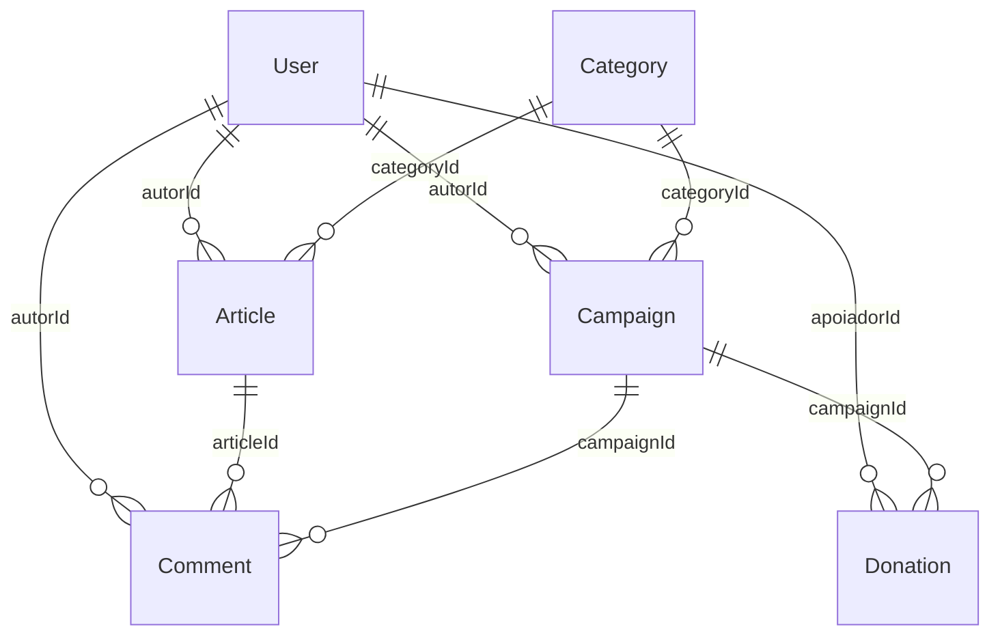

# Modelo de Dados — IFConnect

O banco utiliza Sequelize com suporte a SQLite (local e testes) e PostgreSQL (produção).

## Diagrama Entidade-Relacionamento

## Entidades de negócio

- **`User` (tabela `users`):** `id` (UUID), `nome`, `email` (único), `senhaHash`, `tipo` (`estudante`, `jornalista_jovem`, `membro_comunidade`, `professor_moderador`), `instituicao`, `bio`.
- **`Category` (tabela `categories`):** `id` (UUID), `nome` (único), `descricao`. Classificação compartilhada por publicações e projetos.
- **`Article` (tabela `articles`):** `id` (UUID), `titulo`, `resumo`, `conteudo`, `tipo` (`noticia_escolar`, `noticia_global`, `artigo_cientifico`, `texto`, `poema`, `projeto`), `tema` (`cientifico`, `educacional`, `cultural`, `comunitario`), `palavrasChave`, `imagemCapaUrl`, `status` (`rascunho`, `em_revisao`, `publicado`, `recusado`), `visualizacoes`, `autorId`, `categoryId`.
- **`Campaign` (tabela `campaigns`):** `id` (UUID), `titulo`, `descricao`, `metaFinanceira`, `valorArrecadado`, `tema` (`cientifico`, `educacional`, `cultural`, `comunitario`), `palavrasChave`, `imagemCapaUrl`, `prazoFinal`, `status` (`em_analise`, `ativa`, `financiada`, `encerrada`), `autorId`, `categoryId`.
- **`Donation` (tabela `donations`):** `id` (UUID), `valor`, `mensagemApoio`, `anonimo`, `campaignId`, `apoiadorId`.
- **`Comment` (tabela `comments`):** `id` (UUID), `conteudo`, `editado` (booleano), `autorId`, `articleId` (opcional, `ON DELETE CASCADE`), `campaignId` (opcional, `ON DELETE CASCADE`).

## Índice vetorial do Assistente de IA

- **`AgentChunk` (tabela `agente_chunks`):** tabela desacoplada sem chaves estrangeiras para `articles` ou `campaigns`, usada pelo pipeline RAG para armazenar apenas conteúdos públicos (`publicado`, `ativa`, `financiada`).
  - Campos: `id` (UUID), `sourceType` (`artigo` | `campanha`), `sourceId` (UUID), `chunkIndex` (inteiro), `texto` (TEXT), `contentHash` (STRING 64), `embedding` (array numérico serializado em TEXT), `embeddingModel` (STRING), `dim` (inteiro).
  - Índices: único composto em `(sourceType, sourceId, chunkIndex)` e índice em `embeddingModel`.
